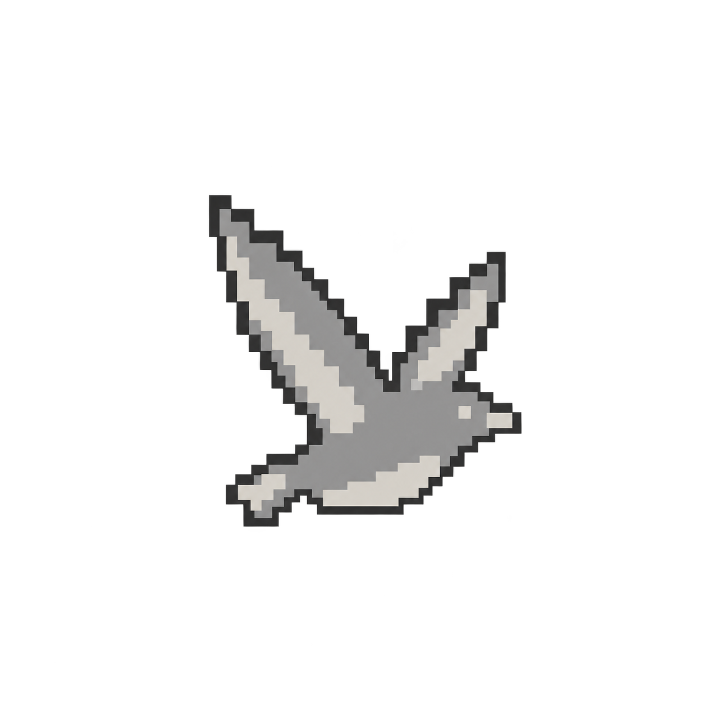

<p align="center">
  
</p>

<h1 align="center">Bird</h1>

<p align="center"><strong>Agent and human friendly containers as a service.</strong></p>

<p align="center">
  <a href="#quick-start">Quick start</a> ·
  <a href="#usage">Usage</a> ·
  <a href="#how-it-works">How it works</a> ·
  <a href="#development">Development</a>
</p>

> [!WARNING]
> **bird is a very, very experimental project.** Expect breaking changes, bugs and missing features. Use it to experiment with workloads and data you can lose, not in production.

bird is a self-hostable platform for deploying containerized apps, written in Rust. It runs containers with rootless Podman, keeps its state in SQLite, routes traffic through its own HTTP/HTTPS proxy and comes with a web dashboard.

## Quick start

On a Linux server with Podman 5 or newer, as the user bird should run as:

```sh
curl -fsSL https://raw.githubusercontent.com/aelpxy/bird/main/install.sh | bash
```

It installs podman if needed, downloads bird, starts it as a systemd user service and prints the dashboard's address with an admin to sign in as. Run it again to upgrade; `--help` lists its options. To reach the dashboard at a domain over HTTPS, point the domain's DNS at the server and add `bash -s -- --acme-email you@example.com --dashboard-domain bird.example.com`. Prebuilt binaries of every commit on `main` are on the [edge release](https://github.com/aelpxy/bird/releases/tag/edge), including the `bird` cli for macOS.

## Usage

```sh
bird deploy web docker.io/library/nginx:alpine --domain web.example.com

cd my-app
bird init                              # writes bird.toml, builds ./Dockerfile
bird deploy
bird status
bird logs -f
bird scale 3
bird rollback
bird exec                              # a shell in a running machine
bird connect -s postgres               # its port on localhost, for psql or a GUI

bird add postgres                      # templates: postgres, mysql, valkey and more
bird env set DATABASE_URL='${{postgres.DATABASE_URL}}'
bird backup schedule -s postgres --every 1d --keep 7
```

Commands act on the service in `./bird.toml`, or the one named with `-s`. Run `bird --help` for everything else: projects and environments, volumes, cron jobs, users and orgs, private registries.

A `bird.toml` is one service ([every field](docs/bird-toml.md)):

```toml
name = "api"
image = "ghcr.io/acme/api:1.4"         # or a [build] section
port = 3000
domains = ["api.example.com"]
release = ["bin/migrate"]              # runs before each deploy's new machines start

[env]
DATABASE_URL = "${{postgres.DATABASE_URL}}"
```

To deploy on every push, use the [GitHub Action](docs/github-actions.md). For AI coding agents, [skills/bird/SKILL.md](skills/bird/SKILL.md) teaches them to deploy with bird; copy it into `.claude/skills/bird/` or point your agent at it.

## How it works

- Deploys start new machines and move traffic only once they pass a health check; a failed deploy keeps the old ones serving.
- The proxy routes by hostname and gets Let's Encrypt certificates for your domains with `--acme-email`. Per app, the dashboard sets rate limits, body and timeout limits, security and custom headers, domain redirects and a maintenance page; every answer names the machine that served it in `x-machine-id`.
- Each environment has its own private network; services find each other by name.
- A supervisor restarts stopped machines and replaces unhealthy ones.

## Development

```sh
pnpm --dir frontend install && pnpm --dir frontend build   # the dashboard, embedded into birdd
cargo build --release
cargo test -- --include-ignored                             # ignored tests need the Podman socket
```

API docs are at `/docs` on the API port.

## License

[Apache License 2.0](LICENSE).
